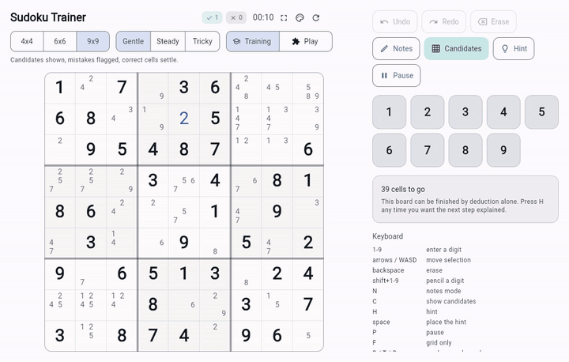
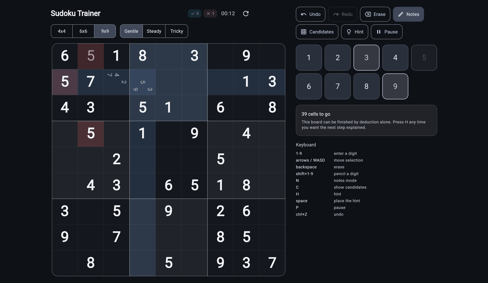
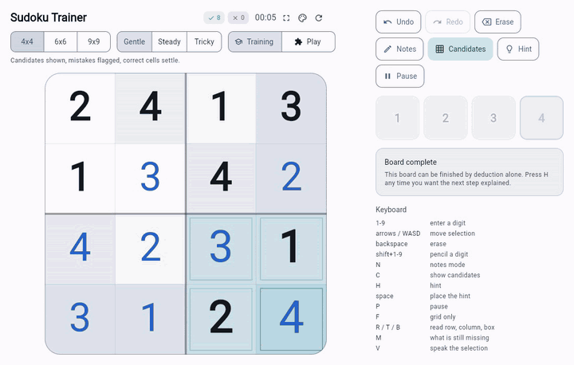
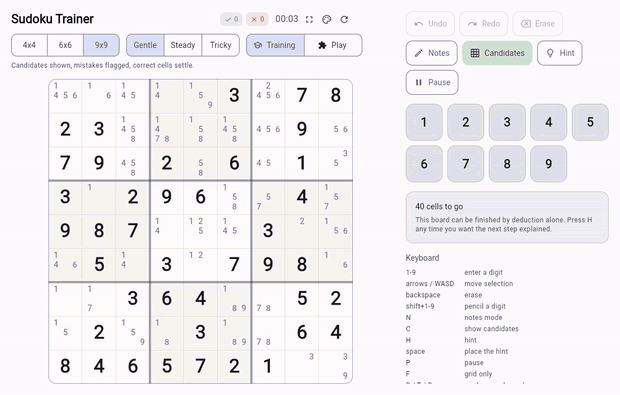
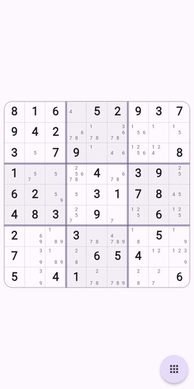

# Sudoku Trainer

A Sudoku app built to *teach* Sudoku. Press `H` and it names the technique that
cracks the next cell and explains why — then highlights the evidence.



Plays 4×4, 6×6 and 9×9. Flutter, web first, **no runtime dependencies**.

Started during the COVID lockdowns as a way to learn Flutter and rebuilt in
2026. Two debts worth naming up front: the solver is a port of
**[Peter Norvig's constraint-propagation essay][norvig]**, still the clearest
explanation of why Sudoku yields to two simple rules; and the idea that a
Sudoku app should *teach* rather than merely test owes a lot to
**[KrazyDad's puzzles][krazydad]** and the care he puts into graded difficulty.

[norvig]: https://norvig.com/sudoku.html
[krazydad]: https://krazydad.com/sudoku/

---

## Why three board sizes

A learning ladder, not a gimmick:

| Size | Boxes | What it teaches |
| --- | --- | --- |
| 4×4 | 2×2 | The three constraints, with almost nothing to search |
| 6×6 | **2 rows × 3 cols** | Box scanning, where boxes are *not* square |
| 9×9 | 3×3 | The real game |

6×6 is the interesting one. Its boxes are two rows tall and three columns wide,
so every part of the engine — geometry, generation, even the layout of pencil
marks inside a cell — has to handle non-square boxes rather than assuming
`√n × √n`.

## What it does

**Explained hints.** Not just the answer: *"In this column, 4 fits nowhere
except row 7, column 3."* The cells that justify it light up. Hints are answers
you can check, not answers you have to trust.

**Candidate marks.** Every empty cell can show the digits its peers still
permit, struck off live as you fill the board — the same computation the solver
runs.

**Two modes, because assistance should be a choice.** **Training** shows
candidates, flags a wrong digit as you type it, and settles the ones you get
right. **Play** flags only what breaks a rule — a legal-but-wrong digit stays
exactly where you put it, and correct cells don't lock, so you can't find an
answer by trying digits until one sticks. The app checks against the solution
either way; the mode decides whether it *says* so.

**Honest difficulty.** `Gentle` and `Steady` are *provably* finishable by
deduction alone. `Tricky` digs as deep as uniqueness allows and then reports
what it actually produced — about half of 9×9 `Tricky` boards genuinely need a
guess, and the app says which.

**Pencil marks you can tell apart.** Your own marks are drawn rotated a quarter
turn; the app's computed candidates are not. *I think* versus *I know*.



### Finishing

A completed row, column or box sends a wave of light along it, travelling
outward from the cell you just played. Finishing the board sweeps the whole
grid, then reports how it went:



Best times are kept per size, difficulty **and** mode — a Play time and a
Training time measure different games, so they don't share a record.

## Skins

Six identities. Each sets its own palette, board proportions, line weights,
typeface and control shapes — not just colours — with light and dark for every
one.



Typography ships as ASCII subsets of three families at two weights each:
**104 KB for all six files**, against about 4.4 MB for the full families.
`tool/subset_fonts.py` regenerates them; all three are SIL OFL 1.1, attributed
in [`assets/fonts/ATTRIBUTION.md`](assets/fonts/ATTRIBUTION.md).

## On a phone

The board takes the whole screen in either orientation. No title, no digit pad,
no panel — digits are entered through the cell menu, and everything else lives
behind one floating button that fans out over the board.



Larger viewports get the full layout instead — side panel, digit pad, hint
explanation, keyboard reference — because there's room for it. **`F`, or the ⛶
button, drops any window to the grid alone**, so the clean view isn't something
only a phone can have.

## Controls

Fully playable from the keyboard, which is how most people will use it on the
web.

| Key | Action |
| --- | --- |
| `1`–`9` | Enter a digit (press again to clear) |
| `Shift`+`1`–`9` | Pencil a digit without changing mode |
| Arrows / `WASD` | Move the selection |
| `Backspace` | Erase |
| `N` / `C` | Notes mode / candidate marks |
| `H` then `Space` | Explain the next move, then place it |
| `R` / `T` / `B` | Read this row, column or box aloud |
| `M` | What each unit still needs |
| `V` | Speak each cell as you move to it |
| `P` / `F` | Pause (hides the board) / grid only |
| `Ctrl`+`Z` | Undo |

Pointer input works the way the original did: **click a cell** for the answer
menu, **long-press or right-click** for the pencil menu. The menu opens on the
cell, so entry costs no pointer travel, and its digits are laid out on the
variant's own box grid.

## Accessibility

The board is painted to a canvas, which is what makes it fast — and what makes
it one opaque rectangle to a screen reader unless its contents are published
separately. They are: `CustomPainter.semanticsBuilder` emits a node per cell,
built from the same snapshot the painting uses, so the two can't drift.

A cell reads as *"row 4, column 7, empty, candidates 2, 5 and 9"*, or
*"row 1, column 3, 5, clue"*.

**Reading a cell is the easy half.** The hard half is *scanning* — your eye
sweeps a row in a moment, and without that the only alternative is stepping
through nine cells and holding them in memory. That, not digit entry, is what
makes Sudoku awkward to play by ear. So the board answers questions instead:
`R`/`T`/`B` read a unit out, `M` says what each unit still needs, and `V`
speaks the selection without any screen reader involved.

A paused board reads as hidden rather than reading its digits out, and
candidates are spoken only once the player has asked to see them — a listener
gets the same assistance as everyone else, not more.

A **High contrast** skin serves low vision, a different need from blindness:
black on white, heavy rules, no wash behind the digits. It clears AAA.

Every animation honours **`prefers-reduced-motion`** — the completion sweep,
the hint fade, the radial fan, the result card and the theme crossfade all
collapse to nothing.

Colours are held to WCAG 2.1 by `test/accessibility_test.dart`, which measures
every text-on-background pair the board can produce, translucent highlights
included. It found candidate marks failing small-text contrast in **every
palette the app had**; they were corrected rather than excused. The audit
iterates `Skin.all`, so a new skin is measured the moment it's listed.

## Architecture

```
lib/
  engine/     pure Dart, zero platform imports — web, iOS and the VM alike
    variant.dart    board sizes, precomputed units and peers
    solver.dart     constraint propagation + search
    puzzle.dart     immutable puzzle, difficulty tiers
    generator.dart  generate-and-dig with a uniqueness check
    hint.dart       candidates, conflicts, explained hints, spoken queries
  state/
    game_controller.dart   the board being played, undo/redo, clock
    game_mode.dart         training vs play
    persistence.dart       snapshots of a game, its settings and best times
    storage/               a tiny key-value port: localStorage, or a stub
  ui/
    board/          the canvas board: painter, glyph cache, hit testing,
                    and the digit menu that opens on a cell
    skins.dart      the six identities, and the theme they build
```

`engine/` imports nothing but `dart:math`. That's the whole iOS-portability
story: there's no platform code to port, and it's covered by tests that run on
the Dart VM in about a second.

### The solver

Norvig's constraint propagation. After every assignment two rules run to
fixpoint, and what survives is searched most-constrained-cell-first:

1. If a cell has one candidate left, eliminate it from that cell's peers.
2. If a unit has only one place left for a digit, assign it there.

Candidates are **bitmasks** — bit `d-1` set means digit `d` is still possible —
so a cell is one `int` and propagation is bit arithmetic. Masks are at most 9
bits, inside the 32-bit range that bitwise operators guarantee on every Dart
backend, `dart2js` included. A 9×9 with the minimum 17 clues solves in ~2 ms.

Those two rules are exactly the naked-single and hidden-single techniques,
which is what makes the difficulty claim checkable: a board is "solvable by
deduction alone" precisely when propagation alone finishes it.

### Generation, and how it's verified

Fill a random complete board, then remove clues one at a time, keeping each
removal only while the board still admits **exactly one** solution. Uniqueness
is re-checked on every dig. Worst case ~24 ms, and only when a puzzle starts.

`test/generator_audit_test.dart` cross-checks it against an *independent*
brute-force counter that derives units from arithmetic rather than from
`Geometry`, so a shared bug can't hide behind a shared assumption. A wider
sweep — **336 puzzles, 5.58 M backtracking nodes** — agreed on every one:
uniqueness, validity, given-consistency, the logic-only claim, and no repeats.

Measured separately: across **1,350 generated boards, every one has a deducible
opening**. `Tricky` never forces a guess on move one; it gets stuck later, and
opens with the harder hidden-single pattern 40% of the time against `Gentle`'s
12%.

### Why the board is one canvas

A single `CustomPaint`, not a widget per cell. A 9×9 showing candidates needs
several hundred glyphs, and laying those out every frame is what makes a canvas
board stutter — so digits are laid out once into a `GlyphCache` and reused
until the cell size or colours change. Cell boundaries snap to whole physical
pixels, without which an arbitrary width divided nine ways puts grid lines on
fractional pixels and the grid renders soft.

## Running it

```bash
flutter pub get
flutter run -d chrome          # development
flutter test                   # 155 tests, ~15s
flutter analyze --fatal-infos
```

```bash
flutter build web --release --wasm --no-web-resources-cdn
```

`--no-web-resources-cdn` is not optional here. Without it Flutter fetches the
renderer from `www.gstatic.com` at runtime — and its default font from
`fonts.gstatic.com` — even though the build ships local copies. That makes an
installed app useless offline and puts a third-party request on every load.

### Deploying

`.github/workflows/deploy.yaml` publishes the **WasmGC** build to GitHub Pages
on every push to `master`. One build serves everyone: browsers with WasmGC run
`main.dart.wasm`, the rest take the JS fallback the same build contains.

Verified in Chrome 152, both paths:

| | First load, gzipped |
| --- | --- |
| WasmGC (`skwasm`) | **2.18 MB** |
| JS fallback (CanvasKit) | 3.52 MB |

Set cross-origin isolation where you can and skwasm rasterises on web workers:

```
Cross-Origin-Opener-Policy: same-origin
Cross-Origin-Embedder-Policy: require-corp
```

Without them it still loads and paints, just single-threaded — which is why
Pages gets the wasm build despite being unable to set headers. `web/_headers`
carries them for Netlify and Cloudflare Pages. Serve `.wasm` and `.js` with
Brotli. About 1.5 MB of either payload is the Skia renderer: a framework floor,
not something the app controls, and it caches after the first visit.

## Installing it

The web build is a proper PWA: a manifest with maskable icons, home-screen
shortcuts that open straight into a board, iOS startup images for every common
device size, and a service worker that precaches the shell so it opens with no
network at all.

| Shortcut | Opens |
| --- | --- |
| Quick 4x4 | `?size=4` |
| New 9x9 | `?size=9` |
| 9x9, no help | `?size=9&mode=play` |

Those are plain links, so they work pasted anywhere, not just from a
home-screen icon. `?size=`, `?difficulty=` and `?mode=` are read at launch;
anything unrecognised is ignored rather than refused. A link naming a board
starts that board; a plain link resumes whatever you were playing.

The service worker is ours, not Flutter's. As of 3.47 Flutter's own is
deprecated, no longer registered by the bootstrap, and ships as a stub that
unregisters itself — a stock build of this version caches nothing and will not
open offline. Ours precaches the shell explicitly, because under cross-origin
isolation the renderer runs on web workers whose fetches never pass through a
service worker, and those are exactly the files whose absence leaves a blank
page. When a new build is deployed it offers a reload rather than taking one:
discarding the board someone is looking at would be worse than being a version
behind.

**Native iOS and Android shells are scaffolded but unbuilt** — neither
toolchain was available on the machine this was developed on.

## Status

Playable and feature-complete on the web. Your game survives a reload — board,
pencil marks, clock, counters, skin and mode — through a small `KeyValueStore`
port backed by `localStorage`, with an in-memory stub elsewhere. No dependency
and no database: a game in progress is one or two kilobytes of JSON.

**[Known gaps and technical debt](docs/TECH_DEBT.md)** is the honest list.
Nothing on it is red; the heaviest remaining item is simply what Flutter web
costs to load.

The engine needs no changes to reach iOS, and persistence needs only one more
implementation of the same interface. The application id is `io.github.conatarun.fsudoku`, a neutral
namespace worth changing before any store submission.

## History

Built during the COVID lockdowns as a first Flutter project, rewritten in 2026.
The original was pre-null-safety Dart 2.7, with six abandoned UI dependencies
and `dart:io` imports that could never have compiled for the web.

The constraint solver survived, reworked onto bitmasks. So did the interaction
design: the at-cell digit menus, the long-press pencil, rotated pencil marks,
immediate right/wrong feedback, locking solved cells, the completion flash, the
move counters and pausing by hiding the board are all the original's ideas,
rebuilt rather than replaced.

## License

MIT — see [LICENSE](LICENSE).
