# Sudoku Trainer

A Sudoku app built to *teach* Sudoku. It plays 4×4, 6×6 and 9×9 boards, shows
you the candidates for every empty cell, and — when you get stuck — names the
technique that cracks the next cell and explains why it works.

Flutter, targeting the web first. No runtime dependencies.

Started during the COVID lockdowns as a way to learn Flutter, and rebuilt in
2026. Two debts worth naming up front: the solver is a port of
**[Peter Norvig's constraint-propagation essay][norvig]**, which is still the
clearest explanation of why Sudoku yields to two simple rules; and the idea
that a Sudoku app should *teach* rather than merely test owes a lot to
**[KrazyDad's puzzles][krazydad]** and the care he puts into graded difficulty.

[norvig]: https://norvig.com/sudoku.html
[krazydad]: https://krazydad.com/sudoku/

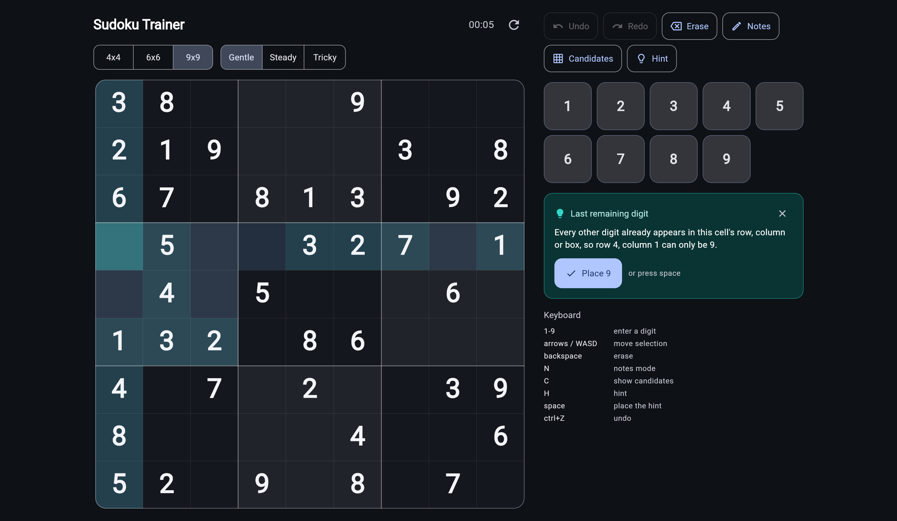

## Why the three board sizes

They are a learning ladder, not a gimmick:

| Size | Boxes | What it teaches |
| --- | --- | --- |
| 4×4 | 2×2 | The three constraints, with almost nothing to search |
| 6×6 | **2 rows × 3 cols** | Box scanning, where boxes are *not* square |
| 9×9 | 3×3 | The real game |

The 6×6 case is the interesting one. Its boxes are two rows tall and three
columns wide, so every piece of the engine — geometry, generation, the notes
layout inside a cell — has to handle non-square boxes rather than assuming
`√n × √n`.

## What it does

**Candidate marks.** Every empty cell can show the digits its peers still
permit, struck off live as you fill the board. This is the single biggest
"oh, I see it" feature, and it is the same computation the solver runs.

**Explained hints.** Press `H` and the app names the technique and the
reasoning — *"In this column, 4 fits nowhere except row 7, column 3"* — then
highlights the cells that justify it. Hints are answers you can check, not
answers you have to trust.

**Live conflict feedback.** A repeated digit is flagged the moment you enter
it, with the peer it collides with highlighted. If the board has become
unsolvable in a subtler way (a blank cell with no legal digit left), the app
says so rather than letting you grind on a dead position.

**Honest difficulty.** `Gentle` and `Steady` boards are *provably* finishable
by deduction alone. `Tricky` digs as deep as uniqueness allows and then tells
you the truth about what it produced — roughly half of 9×9 `Tricky` boards
genuinely require a guess, and the app says which.

**Two modes, because assistance should be a choice.** **Training** shows
candidates, flags a wrong digit as you type it, and settles the ones you get
right so a stray keystroke cannot undo progress. **Play** flags only what
breaks a rule — a legal-but-wrong digit stays exactly where you put it, and
correct cells do not lock, so you cannot find an answer by trying digits until
one sticks. The app checks against the solution either way; the mode decides
whether it says so.

Pausing hides the board rather than just stopping the clock, and the move
counters appear only in Training, where the app has already told you which
moves were mistakes.

**Completion flourishes.** Finishing a row, column or box sends a wave of light
along it, travelling outward from the cell you just played and lifting each
digit as it passes — so the animation reads as a consequence of your move.
Finishing the board sweeps the whole grid, then reports how it went:

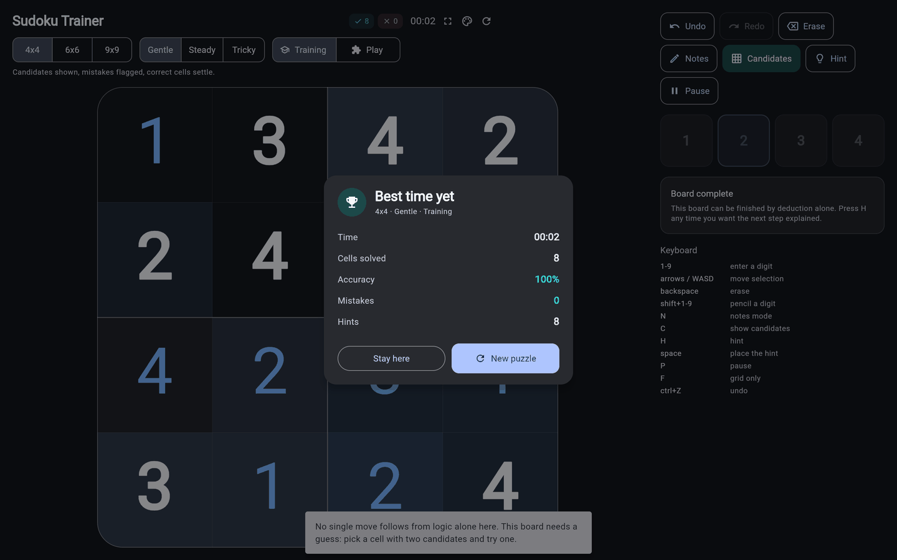

Best times are kept per size, difficulty **and** mode — a Play time and a
Training time are not comparable, so they do not share a leaderboard.

**Pencil marks you can tell apart.** Your own marks are drawn rotated a quarter
turn; the app's computed candidates are not. That separation — *I think* versus
*I know* — is carried over from the first version of this app, where the whole
cell rotated. Here only the mark layer does, so block separators stay on the
right edges.

## Skins

Five identities, each setting its own palette, board proportions, line weights,
typeface and control shapes — not just colours. Light and dark for every one.

| | |
| --- | --- |
| 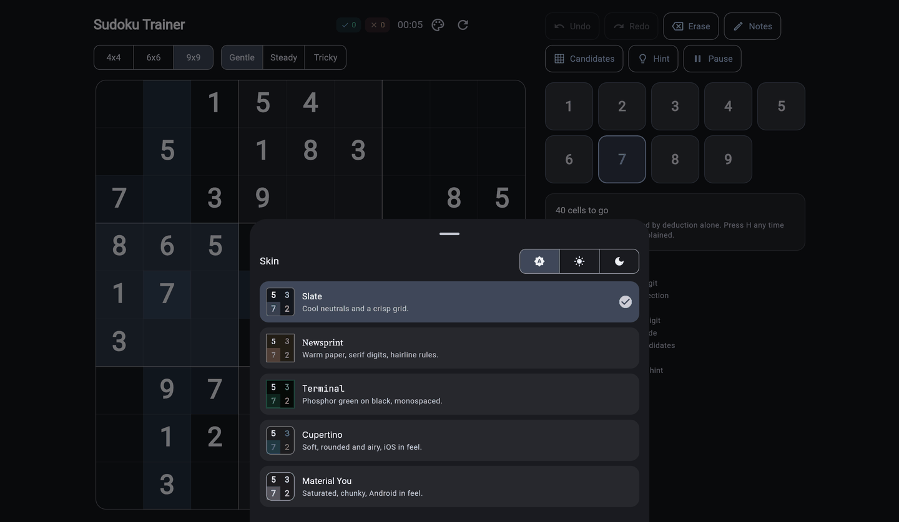 | 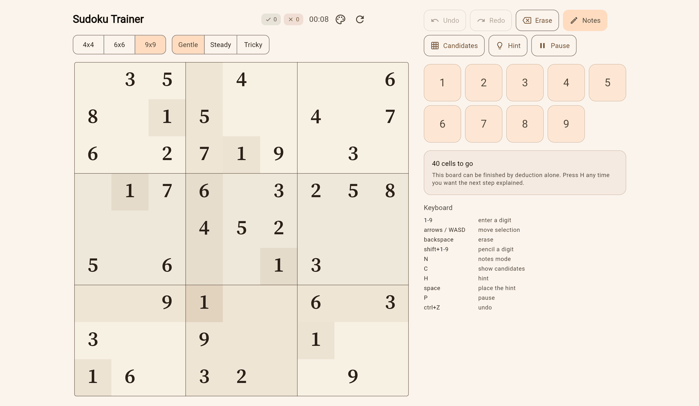 |
| **Slate** · cool neutrals, crisp grid. **Material You** · saturated, chunky. | **Newsprint** · warm paper, serif digits, banded shading, hairline rules. |
| 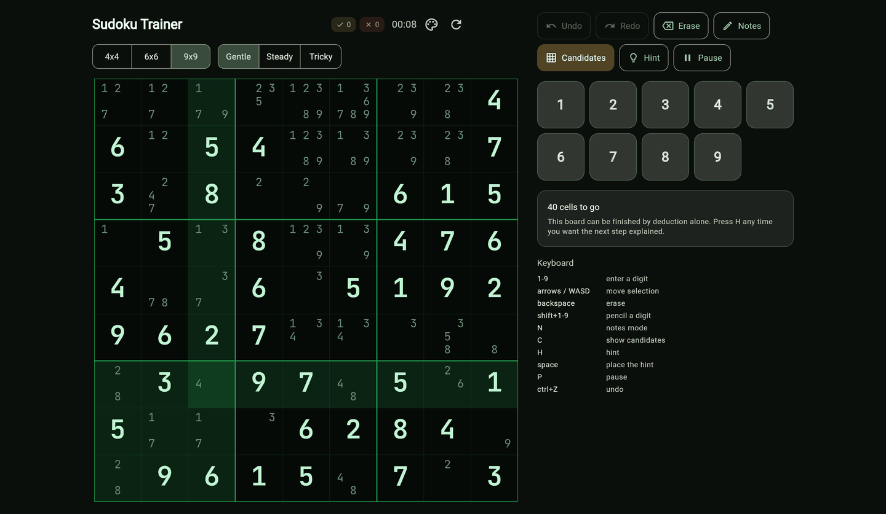 | 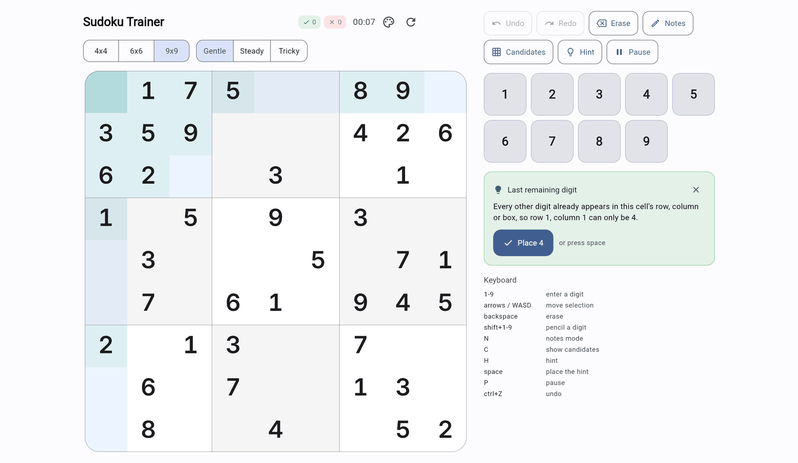 |
| **Terminal** · phosphor on black, monospaced, square corners, no box tint. | **Cupertino** · soft, generously rounded, iOS in feel. |

Typography ships as ASCII subsets of three families at two weights each —
**104 KB for all six files**, against about 4.4 MB for the full families.
`tool/subset_fonts.py` regenerates them; all three families are SIL OFL 1.1,
attributed in [`assets/fonts/ATTRIBUTION.md`](assets/fonts/ATTRIBUTION.md).

## Accessibility

The board is painted to a canvas, which is what makes it fast — and what makes
it one opaque rectangle to a screen reader unless its contents are published
separately. They are: `CustomPainter.semanticsBuilder` emits a node per cell,
built from the same snapshot the painting uses, so the two cannot drift apart.

A cell reads as *"row 4, column 7, empty, candidates 2, 5 and 9"*, or
*"row 1, column 3, 5, clue"*, or *"…, 5, incorrect"*. Activating one selects it
and opens the digit menu, which is built from ordinary widgets and so was
already readable. A paused board reads as hidden rather than reading its digits
out, and candidates are spoken only once the player has asked to see them — a
listener gets the same assistance as everyone else, not more. Hints and a
finished puzzle are announced.

`test/semantics_test.dart` asserts all of it, because nothing on screen reveals
whether it is right. Every one of its checks fails if the semantics layer is
removed.

Every skin's colours are held to WCAG 2.1 contrast minimums by
`test/accessibility_test.dart`, which measures each text-on-background pair the
board can actually produce, translucent highlights included. It found that
candidate marks failed small-text contrast in **all ten** palettes; they were
corrected rather than excused.

## On a phone

The board takes the whole screen, in either orientation. There is no title, no
digit pad and no panel: digits are entered through the cell menu, and
everything else lives behind one floating button that fans its actions out over
the board.

| Portrait controls | Landscape |
| --- | --- |
| 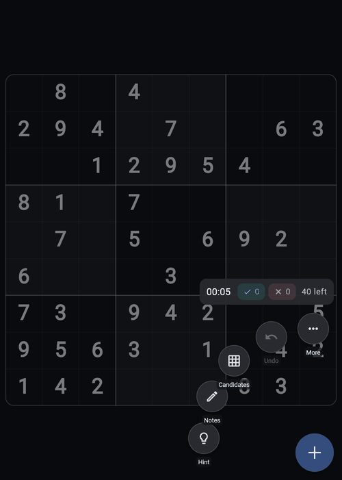 | 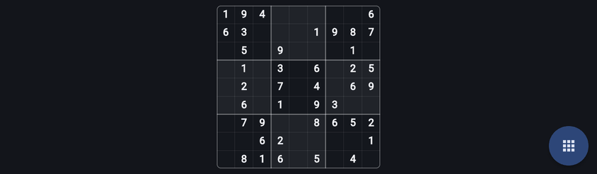 |

Larger viewports get the full layout instead — side panel, digit pad, hint
explanation and keyboard reference — because there is room for it. **`F`, or
the ⛶ button in the header, drops any window to the grid alone**, so the clean
view is not something only a phone can have.

Your rotated pencil marks beside the app's upright candidates, and the digit
menu open on a cell:

| Pencil marks | Cell menu |
| --- | --- |
|  | 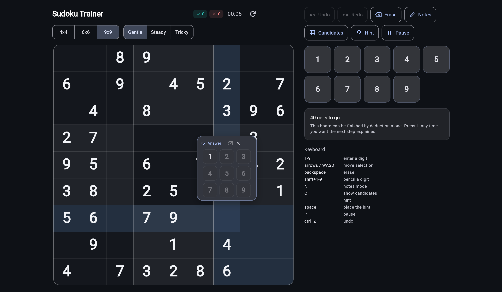 |

| Candidates | Light | Narrow |
| --- | --- | --- |
| 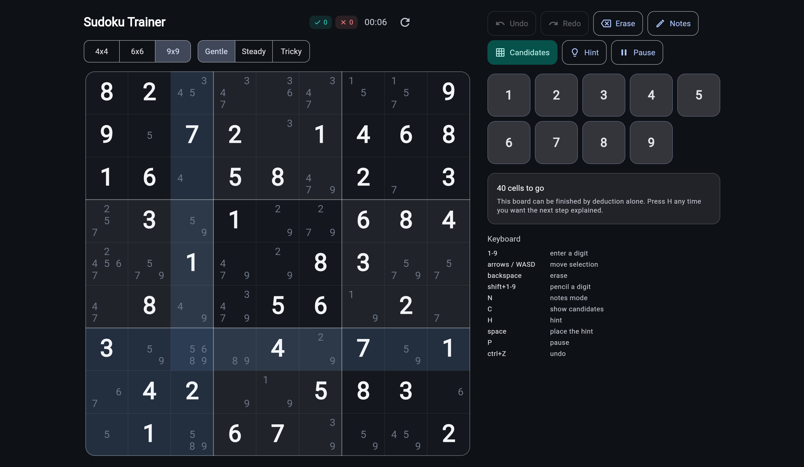 | 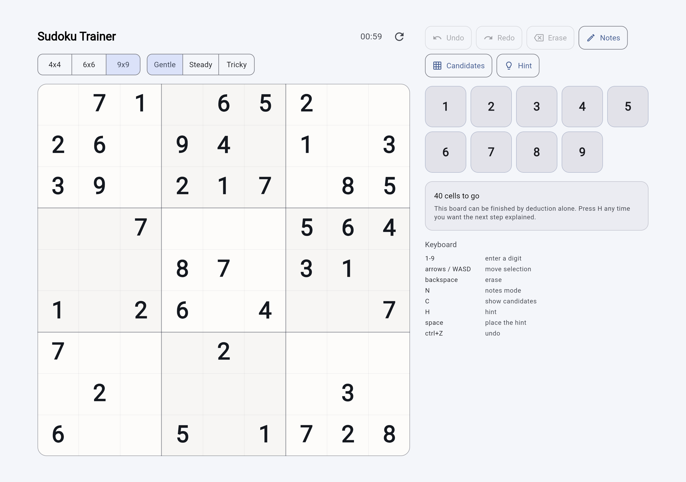 | 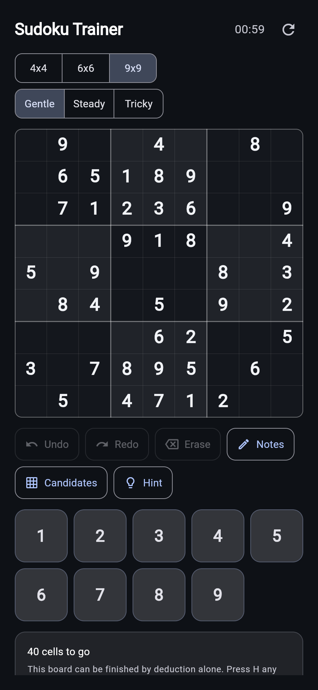 |

## Controls

Fully playable from the keyboard, which is how most people will use it on the web.

| Key | Action |
| --- | --- |
| `1`–`9` | Enter a digit (press again to clear) |
| Arrows / `WASD` | Move the selection |
| `Backspace` / `Delete` | Erase |
| `N` | Notes (pencil-mark) mode |
| `C` | Toggle candidate marks |
| `H` | Explain the next move |
| `Space` / `Enter` | Place the explained move |
| `Shift`+`1`–`9` | Pencil a digit without changing mode |
| `P` | Pause (hides the board) |
| `F` | Grid only — hide the panel at any window size |
| `Ctrl`+`Z` / `Ctrl`+`Shift`+`Z` | Undo / redo |
| `Esc` | Dismiss the hint, then clear the selection |

Pointer input works the way the original did: **click a cell** for the answer
menu, **long-press or right-click** for the pencil menu. (The browser's own
context menu is suppressed, since right-click is a game gesture here.) The menu opens on the
cell, so entry costs no pointer travel, and its digits are laid out on the
variant's own box grid — the same arrangement the board and the pencil marks
use.

## Architecture

```
lib/
  engine/     pure Dart, zero platform imports — runs on web, iOS and the VM
    variant.dart    board sizes, precomputed units and peers
    solver.dart     constraint propagation + search
    puzzle.dart     immutable puzzle, difficulty tiers
    generator.dart  generate-and-dig with a uniqueness check
    hint.dart       candidates, conflicts, explained hints
  state/
    game_controller.dart   the board being played, undo/redo, clock
  state/
    settings_controller.dart  the chosen skin and brightness
    game_mode.dart            training vs play
    persistence.dart          snapshots of a game and its settings
    storage/                  a tiny key-value port: localStorage, or a stub
  ui/
    board/          the canvas board: painter, glyph cache, hit testing,
                    and the digit menu that opens on a cell
    skins.dart      the five identities, and the theme they build
    theme.dart      board design tokens (palette + proportions)
    radial_menu.dart  the phone layout's one control
```

The `engine/` directory imports nothing but `dart:math`. That is the whole
iOS-portability story: there is no platform code to port, and the engine is
covered by tests that run on the Dart VM in about a second.

### The solver

Peter Norvig's constraint propagation. After every assignment, two rules run to
fixpoint, and what survives is searched most-constrained-cell-first:

1. If a cell has one candidate left, eliminate it from that cell's peers.
2. If a unit has only one place left for a digit, assign it there.

Candidates are **bitmasks** — bit `d-1` set means digit `d` is still possible —
so a cell is one `int` and propagation is bit arithmetic. Masks are at most 9
bits, which stays inside the 32-bit range that bitwise operators guarantee on
every Dart backend, `dart2js` included. A 9×9 board with the minimum 17 clues
solves in about 2 ms.

Those two rules are exactly the naked-single and hidden-single techniques, which
is what makes the difficulty claim checkable: a board is "solvable by deduction
alone" precisely when propagation alone finishes it.

### Generation

Fill a random complete board, then remove clues one at a time, keeping each
removal only while the board still admits **exactly one** solution. Uniqueness
is re-checked on every dig. Worst case is ~24 ms on the VM, and it only happens
when you start a puzzle, never while you play.

### Why the board is one canvas

The board is a single `CustomPaint`, not a widget per cell. A 9×9 grid showing
candidates needs several hundred glyphs, and laying those out every frame is
what makes a canvas board stutter — so digits are laid out once into a
`GlyphCache` and reused until the cell size or colours change. Cell boundaries
are snapped to whole physical pixels, without which an arbitrary width divided
nine ways puts grid lines on fractional pixels and the whole grid renders soft.

## Running it

```bash
flutter pub get
flutter run -d chrome          # development
flutter test                   # 138 tests, ~15s
flutter analyze
```

Build for the web:

```bash
flutter build web --release            # CanvasKit
flutter build web --release --wasm     # skwasm (WasmGC), with a JS fallback
```

### Deploying

`.github/workflows/deploy.yaml` publishes the **WasmGC** build to **GitHub
Pages** on every push to `master`. One build serves everyone: browsers with
WasmGC run `main.dart.wasm`, and the rest (Safari) take the JS fallback the
same build already contains.

Measured in Chrome 152, both paths verified:

| | First load, gzipped |
| --- | --- |
| WasmGC (`skwasm`) | **2.18 MB** |
| JS fallback (CanvasKit) | 3.52 MB |

Set **cross-origin isolation** where you can —

```
Cross-Origin-Opener-Policy: same-origin
Cross-Origin-Embedder-Policy: require-corp
```

— and skwasm rasterises on web workers. Without them it still loads and paints,
just single-threaded, which is why Pages gets the wasm build anyway despite
being unable to set headers. `web/_headers` carries them for Netlify and
Cloudflare Pages, along with cache rules, and Flutter copies it into the build
output as-is.

Serve `.wasm` and `.js` with Brotli. About 1.5 MB of either payload is the Skia
renderer — a framework floor, not something the app controls. It caches after
the first visit.

## Status

Playable and feature-complete on the web. **[Known gaps and technical
debt](docs/TECH_DEBT.md)** is the honest list. Nothing on it is red any
more; the heaviest remaining item is simply what Flutter web costs to load.

**Your game survives a reload** — board, pencil marks, clock, counters, skin
and mode — through a small `KeyValueStore` port backed by `localStorage` on the
web and an in-memory stub elsewhere. No dependency and no database: a game in
progress is one or two kilobytes of JSON, and shipping a wasm build of SQLite
to store that would add roughly a megabyte to the payload.

iOS is the next target. The engine needs no changes to get there; the platform
scaffolding is current, and persistence needs only one more implementation of
that same interface. The application id is `io.github.conatarun.fsudoku`, a
neutral namespace worth changing before any store submission.

## History

Built during the COVID lockdowns as a first Flutter project, and rewritten in
2026. The original was pre-null-safety Dart 2.7, with six abandoned UI
dependencies and `dart:io` imports that could never have compiled for the web.

The constraint solver survived, reworked onto bitmasks. So did the interaction
design: the at-cell digit menus, the long-press pencil, rotated pencil marks,
immediate right/wrong feedback, locking solved cells, the completion flash, the
move counters, and pausing by hiding the board are all the original's ideas,
rebuilt rather than replaced.

## License

MIT — see [LICENSE](LICENSE).
